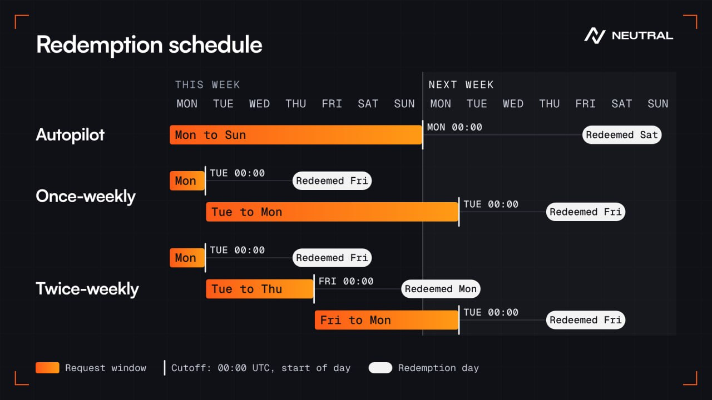

# Fees + Redemption Period

Current Neutral Strategy Vaults charge up to three fees: a management fee, a performance fee on some vaults, and a withdrawal fee. All three are charged by the vault program and shown in each vault's Details view before you deposit. There are no invoices and no hidden charges.

## Fees at a Glance

| Vault                            | Management fee | Performance fee | Withdrawal fee | Minimum deposit |
| -------------------------------- | -------------- | --------------- | -------------- | --------------- |
| Neutral Autopilot                | 1%             | None            | 0.3%           | 100 USDC        |
| Hyperliquid Funding Arb          | 1%             | 20%             | 0.3%           | 100 USDC        |
| Delta Neutral Arbitrage          | 1%             | 20%             | 0.3%           | 100 USDC        |
| Options Market Making            | 1%             | 30%             | 0.3%           | 100 USDC        |
| HFT Multi-factor                 | 1%             | 30%             | 0.3%           | 100 USDC        |
| Mid-frequency Market Making      | 1%             | 35%             | 0.3%           | 100 USDC        |
| CTA - Adaptive Alpha             | 1%             | 25%             | 0.3%           | 100 USDC        |
| CTA - Systematic Alpha           | 1%             | 25%             | 0.5%           | 100 USDC        |
| CTA - Longshort Alpha            | 1%             | 30%             | 0.3%           | 100 USDC        |
| Multi-Asset Volatility Arbitrage | 1%             | None            | 0.3%           | 50,000 USDC     |
| NT Earn                          | None           | None            | None           | 10 USDC         |

Figures are the on-chain settings on 12 October 2026 for vaults on Solana. Meridian Liquidity Provider (Robinhood Chain) and Neutral Autopilot on Ethereum (through Accountable Vaults) run on a different vault contract and list their own terms in the app. If a figure on this page differs from a vault's Details view, the Details view is correct.

## Management Fee

All 12 current Neutral Strategy Vaults have a **1% annual management fee** as their base schedule, except NT Earn, which charges no fees. The management fee accrues over elapsed time and is charged in vault shares.

At a simple annualized rate, 1% is approximately 0.00274% per day. Actual charges use the program's elapsed-time calculation and current user-specific fee setting rather than a rounded daily rate.

A disclosed promotion, VIP discount, or wallet-level fee setting can reduce the management fee actually charged. It does not change the vault's 1% base schedule.

The [Neutral VIP Program](../getting-started/neutral-vip-program.md) currently applies to Neutral Autopilot. Its Silver, Gold, and Diamond tiers reduce the standard 1% annual management fee to 0.90%, 0.80%, and 0.70%, respectively. Performance fees are not discounted.

## Performance Fee

Some vaults also charge a **performance fee**. It applies only to profit above your high-water mark and varies by vault.

If a position has not made a new post-fee profit above its high-water mark, no performance fee is charged for that interval.

The high-water mark is your highest post-fee position value used for performance-fee accounting. On a direct vault position it is tracked per wallet, so another depositor's gains or losses do not change your fee. A new deposit can adjust the account's weighted entry basis according to the vault program rules.

## Withdrawal Fee

A withdrawal fee is deducted from the amount you redeem. It is a one-time charge at settlement, not an annual fee. When you switch between vaults, you pay only the difference if the source vault's withdrawal fee is higher than the destination's. See [How They Work](../neutral-strategy-vaults/how-they-work.md).

## Builder Fee Split

The [Builders Code Rebate](../for-distribution-partners/neutral-builders-code.md) shares part of the management fee with an attributed builder:

* The user-specific management fee is calculated first.
* The builder receives its live per-vault tier percentage of that charged fee.
* The split comes from the manager's fee and does not increase the user's cost.
* Performance fees are excluded from the launched builder ladder.

## Position Values

**Balance** is the current value of your vault shares after charged fees.

**Earnings** is your profit shown after management and performance fees.

**Performance fee paid** is the cumulative performance fee charged on profit above the high-water mark.

## Withdrawals

From 12 October 2026, Neutral Strategy Vaults follow a fixed weekly redemption schedule. Each vault is on one of three schedules: Autopilot, once-weekly, or twice-weekly.

You can submit a withdrawal request on any day. The request joins the next cutoff, and the vault redeems it on the redemption day for that cutoff. Every cutoff is at 00:00 UTC, the start of the day.

<figure><figcaption></figcaption></figure>

### Redemption Schedule

| Schedule     | Request window      | Cutoff (UTC)  | Redemption day            |
| ------------ | ------------------- | ------------- | ------------------------- |
| Autopilot    | Monday to Sunday    | Monday 00:00  | Saturday after the cutoff |
| Once-weekly  | Tuesday to Monday   | Tuesday 00:00 | Friday after the cutoff   |
| Twice-weekly | Tuesday to Thursday | Friday 00:00  | Monday after the cutoff   |
| Twice-weekly | Friday to Monday    | Tuesday 00:00 | Friday after the cutoff   |

A request made on the cutoff day itself falls into the next window. For example, a once-weekly request made on Monday is redeemed that Friday, and a request made on Tuesday is redeemed on Friday of the next week.

### Vaults on Each Schedule

**Autopilot (Saturday redemptions)**

* Neutral Autopilot

**Once-weekly (Friday redemptions)**

* Mid-frequency Market Making
* CTA - Adaptive Alpha
* HFT Multi-factor
* CTA - Longshort Alpha
* CTA - Systematic Alpha

**Twice-weekly (Monday and Friday redemptions)**

* Delta Neutral Arbitrage
* Hyperliquid Funding Arb
* Options Market Making

**Exceptions**

NT Earn, Multi-Asset Volatility Arbitrage, Meridian Liquidity Provider, and Neutral Autopilot on Ethereum do not follow this schedule. They keep their own redemption terms, shown in each vault's Details view.

### Until Settlement

You remain exposed to changes in the vault's price per share until settlement. The value shown when a withdrawal or builder claim is requested is therefore an estimate rather than a fixed redemption amount.

## Common Questions

**What fees does Neutral Trade charge?**

A 1% annual management fee on strategy vaults, a performance fee on some vaults, and a withdrawal fee. NT Earn has no fees.

**Is the performance fee charged on losses?**

No. It is charged only on new profit above your own high-water mark.

**How long does a withdrawal take?**

Between a few days and about two weeks on the weekly schedules, depending on the vault and the day you submit the request.
