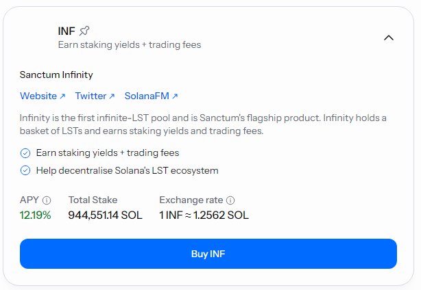

---
metaLinks:
  alternates:
    - >-
      https://app.gitbook.com/s/6YjCIQB3ardoMeqGMIF8/for-capital-allocators/deprecated-vaults/drift-funding-arb-usdc-deprecated
---

# 🏎️ Drift 资金费率套利（USDC）-【已停用】

<figure><figcaption></figcaption></figure>

通过 Drift 资金费率套利金库，为您的 USDC 实现 **7.98% 年化收益率** 的稳健收益。 


视频解说:

[https://www.youtube.com/watch?v=bLGQ1Ba0614](https://www.youtube.com/watch?v=bLGQ1Ba0614)


## **策略运作机制**

基差交易是金融市场中常用于商品、期货及其他衍生品的交易策略，核心是通过捕捉资产现货价格与期货价格之间的价差实现套利。

本策略套利 Sanctum Infinity（$INF），通过循环借贷放大头寸，并在 Drift 上动态分析 SOL-PERP 进行对冲。

## **收益来源解析**

USDC 基准收益金库通过以下多元机会获取收益：$INF 基于 SOL 流动性质押代币的质押收益（通过循环借贷放大）、交易手续费、通过做空 Drift 上的 SOL-PERP 获取的资金费率收益。

**具体收益构成**（截至 2024年11月26日）

1. **INF 质押收益**（2倍循环）：享受 Solana 网络通胀奖励、优先费及 MEV 捕获机会 —— **20.43% 年化收益率**
2. **资金费率收益**：SOL-PERP 资金费率贡献 —— **61.12% 年化收益率**

## **什么是 Sanctum Infinity ($INF) 代币？**

Sanctum Infinity ($INF) 是一个精选的 SOL 流动质押代币（LST）组合篮子，其价值随时间增长而设计。仅需持有 $INF 即可被动赚取收益，收益来源包括聚合的 SOL 质押收益、MEV 机会及交易手续费。


[https://sanctum.so/](https://sanctum.so/)


<figure><figcaption></figcaption></figure>

## **费用与赎回规则**

* **绩效费用**：从本策略为您实现的收益中抽取25%
* **赎回锁定期**：为优化流动性管理与策略收益，设有**1天**的短期锁定期

## 风险提示

由于我们使用 SOL 购买 INF，正常情况下不存在清算风险。仅当 SOL 的借贷利率超过 INF 收益率时，才可能触发清算。不过，我们的策略已设计为一旦出现该情况，将自动解除 INF 的循环借贷头寸。

策略动态调整逻辑:

* _资金费率为正时：_&#x4E13;注基差交易与 $INF 循环借贷
* _资金费率为正，但 SOL 借贷利率过高时：_&#x5207;换至纯基差交易模式
* _资金费率连续5天为负时：_&#x7EF4;持 $INF 循环借贷，并反转基差头寸方向
* _资金费率为负，且 SOL 借贷利率过高时：_&#x5207;换至纯基差交易模式
* _两项条件均不利时：_&#x7B56;略持有 USDC 转为防御状态

这种动态调整机制确保了策略始终保持高效运行，同时规避不必要的风险。

## 交易查询入口 (Drift)


[https://app.drift.trade/?authority=CxL8eQmGhN9LKSoHj7bU95JekFPtyZoUc57mbehb5A56](https://app.drift.trade/?authority=CxL8eQmGhN9LKSoHj7bU95JekFPtyZoUc57mbehb5A56)


## 存入链接:

Neutral Trade 官网 (主要入口):


[https://www.app.neutral.trade/strategies/solbasisinf](https://www.app.neutral.trade/strategies/solbasisinf)


Drift 官网 (备选入口):


[https://app.drift.trade/vaults/strategy-vaults/CxL8eQmGhN9LKSoHj7bU95JekFPtyZoUc57mbehb5A56](https://app.drift.trade/vaults/strategy-vaults/CxL8eQmGhN9LKSoHj7bU95JekFPtyZoUc57mbehb5A56)


***

USDC Basis启用日期 -  2024-11-28

