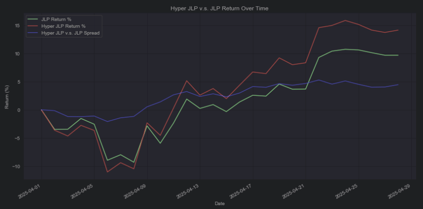

---
metaLinks:
  alternates:
    - >-
      https://app.gitbook.com/s/6YjCIQB3ardoMeqGMIF8/for-capital-allocators/deprecated-vaults/hyper-jlp-deprecated
---

# 💥 Hyper JLP- -【已停用】

## 策略详解

持有 $JLP，但对 ETH、SOL（非 LST 形式）、wBTC、闲置稳定币或交易员盈亏波动不感兴趣？我们为您量身打造了专属方案。

欢迎了解 **Hyper JLP**！

\
这是一款基于 JLP 却彻底重构的收益型指数产品。

<figure><figcaption></figcaption></figure>

## **策略运作机制**

Hyper JLP 是一个由顶级表现资产构成的组合篮子。作为一款生息型产品，它让您在获得大盘代币敞口的同时，还能赚取额外收益。

### **指数成分构成：**

* **HYPE**：快速增长生态中的头部表现资产
* **cbBTC**：通过 cbBTC 降低交易对手风险的比特币敞口
* **dSOL**: 生息型 SOL 流动性质押代币
* **JLP DN:** Delta 中性策略，捕获交易、清算及借贷费用收益

### 收益来源:

* 借贷收益
* 质押收益
* Delta 中性策略收益

### **牛市中的完整上涨收益**

• **无交易员盈亏（PnL）拖累**

**Hyper JLP** 不承担交易员盈亏风险。这意味着在上涨行情中，您可完整享受底层代币的全部涨幅，无需为交易员的盈利分摊成本。

<figure><figcaption></figcaption></figure>

## 存入链接:


[https://www.app.neutral.trade/strategies/hyperjlp](https://www.app.neutral.trade/strategies/hyperjlp)


### 交易查询入口 (Drift):


[https://app.drift.trade/?authority=A1B9MVput3r1jS91iu8ckdDiMSugXbQeEtvJEQsUHsPi](https://app.drift.trade/?authority=A1B9MVput3r1jS91iu8ckdDiMSugXbQeEtvJEQsUHsPi)


***

Hyper JLP 启用日期 — 2025-05-03
