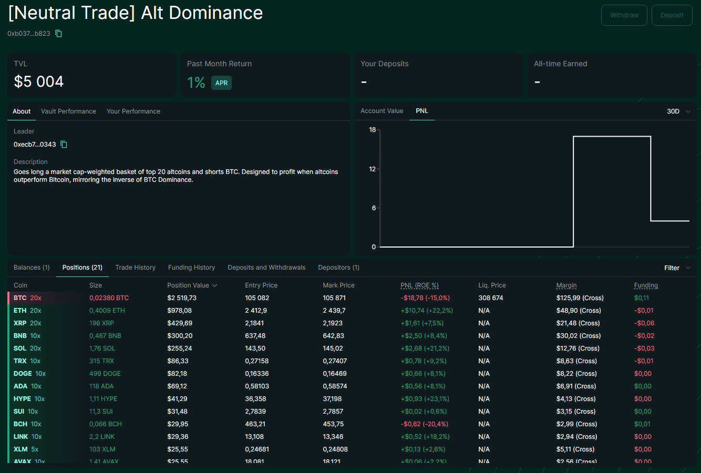

# \[Hyperliquid] 山寨币主导策略 -【已停用】

<figure><figcaption></figcaption></figure>

Neutral Trade 现已正式上线 Hyperliquid——首发推出我们的[资金费率套利策略](https://app.gitbook.com/o/8BrTz5uVFY2dUubyr6ic/s/TBbIFSVhH4bZpN1NJyUi/~/changes/1/zhu-yao-chan-pin/liang-hua-ce-le-mo-kuai/shi-chang-zhong-xing-ce-le/hyperliquid-zi-jin-feiltao-li-ce-le-usdc)，并同步上线两款全新的主导权金库，这些产品均直接构建于 Hyperliquid 原生金库基础设施之上。


在 Hyperliquid 上享更多优惠！使用我们的推荐码：

[https://app.hyperliquid.xyz/join/NEUTRALTRADE](https://app.hyperliquid.xyz/join/NEUTRALTRADE)


<figure><figcaption></figcaption></figure>

## 🤔 **什么是主导权？**

主导权反映了特定资&#x4EA7;**（比特币或山寨币）**&#x5728;整个加密市场总市值中所占的比例。

### ➗**计算公式：**

$$
\text{Dominance}_{BTC} = \frac{\text{Market Cap}_{BTC}}{\sum_{i=1}^{N} \text{Market Cap}_i}
$$

该比率反映资金流向：

* **BTC主导率上升** → 资金正涌入比特币（避险模式）
* **BTC主导率下降** → 资金正流向山寨币（风险偏好模式）

**山寨币主导率**即为其反向指标：

$$
\text{Dominance}_{ALT} = 1 - \text{Dominance}_{BTC}
$$

## 1. **山寨币主导金库**

<figure><figcaption></figcaption></figure>

#### **该金库瞄准山寨币相对于 BTC 的强势表现——即所谓的“山寨季”**

策略配置：

* 做多前20大山寨币（含 ETH、SOL、MEME 币等）
* 做空 BTC 作为对冲

只要山寨币表现跑赢比特币，无论大盘方向如何，您都能盈利。

### 1.1 **运作机制与特性**

* 全额抵押，1 倍名义风险敞口
* 每日更新的市值加权山寨币组合
* 全自动算法运行（无需手动调仓）
* 市场中立（仅承担 BTC/山寨币主导率风险）

### 1.2 **山寨币主导金库资金流向**



### 1.3 **实时资产配置（示例为最新快照）**

| 资产        | 方向 | 占金库管理资产规模比例 |
| --------- | -- | ----------- |
| 前 20 大山寨币 | 做多 | 49% (市值加权   |
| BTC       | 做空 | 51%         |

### 1.4 权重分布可视化（最新快照）



***

## **该策略盈利逻辑**

加密货币市场并非单纯上涨或下跌——更存在**轮动效应**。

\
时而比特币领涨，时而山寨币爆发。这种交替走势创造了市场中最稳定的规律之一——而主导金库正是为捕捉此规律而生。

### **您的收益来源：**

#### 1. **捕捉资金轮动收益**

市场常在“风险偏好”（资金聚焦山寨币）与“风险规避”（资金回归比特币）两种模式间轮动，形成对立两面。

\
只要其中一方表现优于另一方，即便整体价格横盘，您也能获利。

<figure><figcaption></figcaption></figure>

#### 2. **风险可控的投资配置**

本策略金库将您的头寸分散投资于经严格筛选的多元化资产组合——涵盖主流公链、DeFi 项目、Meme 币与核心大市值代币，有效降低单一资产暴跌或表现不佳对整体组合的影响。

### **策略速览**:

* **BTC 主导金库** → 做多 BTC / 做空山寨币 → 在 BTC 领涨或回调期间表现更佳
* **山寨币主导金库** → 做多山寨币 / 做空 BTC → 在山寨币季节中表现更优
* 完全市场中立，每日自动再平衡与优化
* 操作简单便捷

***

## **费用与赎回规则**

**绩效佣金**：从本策略为您实现的收益中抽取 **10%**

***

## 存入链接:

Neutral Trade 官网 :


[https://www.app.neutral.trade/strategies/](https://www.app.neutral.trade/strategies/hyperjlp)


Hyperliquid 直达链接:

> ALT Dominance Vault: [https://app.hyperliquid.xyz/vaults/0xb03715bec4514ae7d338fcd85053ca227a1fb823](https://app.hyperliquid.xyz/vaults/0xb03715bec4514ae7d338fcd85053ca227a1fb823)

## 交易查询入口 (Hyperliquid)


ALT Dominance Vault: [https://app.hyperliquid.xyz/vaults/0xb03715bec4514ae7d338fcd85053ca227a1fb823](https://app.hyperliquid.xyz/vaults/0xb03715bec4514ae7d338fcd85053ca227a1fb823)


***

**启用日期 - 2025-06-25**
