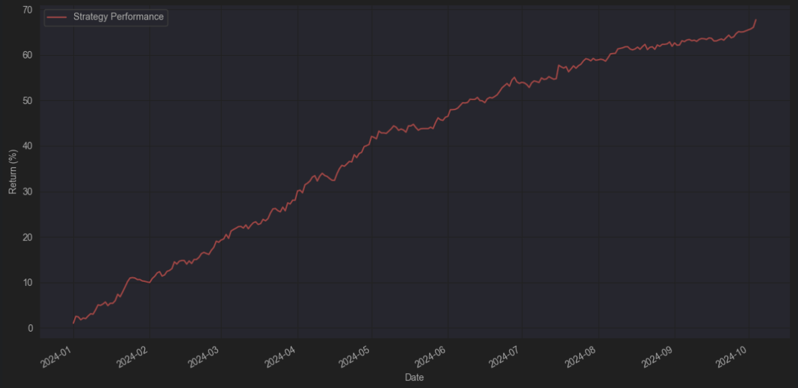

# 🔥 JLP DN on Drift -【已停用】


视频解析：

[https://www.youtube.com/watch?v=EbBLCv0jpCA](https://www.youtube.com/watch?v=EbBLCv0jpCA)


## 策略详解

JLP Delta中性策略运用量化模型与系统化方法，构建独特的收益机制：一方面通过Jupiter平台永续交易者的手续费积累实现基础收益，另一方面在市场条件允许时，利用对冲持仓的资金费率收益实现超额回报。

<figure><figcaption></figcaption></figure>

## 策略设计

JLP Delta 中性策略通过 JLP（Jupiter 流动性提供）获取收益，其收益来源为Jupiter 平台上的交易活动。

该策略采用动态对冲机制消除 JLP 的方向性风险敞口，并通过系统化全天候监控，基于预测手续费收入进行动态杠杆调整，始终保持最低 Delta 风险敞口。

### **收益来源**:

* JLP 收益
  * 建仓/平仓手续费
  * 借贷利息
  * 清算费用
* 资金费率
  * BTC 正向资金费率  (当其为正)
  * SOL 正向资金费率 (当其为正)
  * ETH 正向资金费率 (当其为正)

### 对冲目标:

* BTC, SOL, ETH
  * JLP内未利用的波动性资产
* 活跃交易者头寸
  * Jupiter 交易者的盈亏

### Exposures风险敞口:

* JLP 收益率波动
* 资金费率波动
* 借贷成本波动

### **资金流向**:

{% @mermaid/diagram content="flowchart TD
    %% ────────────────────────────────
    %%  hJLP 2× (USDC) Flow – replica
    %% ────────────────────────────────
    A[User deposit] --> B[Convert USDC to JLP]
    B --> C[Borrow stablecoins / Use spot leverage]
    C --> D[Create Delta Neutral   positions]

    %% Decision: Check risk metrics
    D --> E{Check risk metrics}

    %% Two branches
    E -- Safe --> F[Calculate delta]
    E -- Unsafe --> G[Reduce leverage]
    G --> F

    %% Hedge execution
    F --> H[Execute hedge on Drift]

    %% Monitoring block (multi-line)
    H --> I[Monitor: • Leverage • Borrowing costs • Delta exposure]

    %% Rebalance loop
    I --> J{Rebalance needed?}
    J -- Yes --> D
    J -- No  --> I

    %% ──────────  Optional styling  ──────────
    %% Purple-ish rectangles + white border
    classDef step fill:#2a2d4f,stroke:#7991ff,color:#ffffff,stroke-width:2px;
    %% Green diamonds
    classDef decision fill:#006f3c,stroke:#ffffff,color:#ffffff,stroke-width:2px;
    %% Darker monitor block to match screenshot emphasis
    classDef monitor fill:#1e2040,stroke:#7991ff,color:#ffffff,stroke-width:2px;

    %% Apply classes
    class A,B,C,D,F,H step;
    class G step;
    class E,J decision;
    class I monitor;
" %}

## **策略表现**

The JLP DN Strategy generated a real yield of over 70% APY for the first 3 months after going live. This came primarily from trading, borrowing, and liquidation fees earned from traders using Jupiter perps.

This strategy offers one of the best risk-adjusted returns in the market and works alongside trusted platforms such as Drift and Jupiter, both known for their strong audits and reliability.

Unlike other yield farming opportunities, the JLP DN Strategy offers a unique and reliable way to earn high returns natively without the need for incentives.

JLP Delta 中性策略自上线前三个月内实现了超过 70% 年化收益的实际回报。该收益主要来源于 Jupiter 永续合约交易者产生的交易手续费、借贷利息及清算费用。

本策略提供市场上最佳风险调整回报之一，并与经过严格审计、信誉卓著的Drift 和 Jupiter 等平台协同运作。

相较于其他收益耕作机会，JLP Delta 中性策略通过原生机制提供独特且可靠的高收益途径，无需依赖外部激励措施。

<figure><figcaption></figcaption></figure>

***

## 风险提示



***

JLPDN 启用日期 - 2024-10-1

JLPDN (Drift) V2 启用日期 - 2024-11-12

JLPDN (Drift) V3 启用日期 - 2024-12-23

JLPDN (Drift) V4 启用日期 - 2025-01-23

JLPDN (Drift) V5 启用日期 - 2025-01-24
