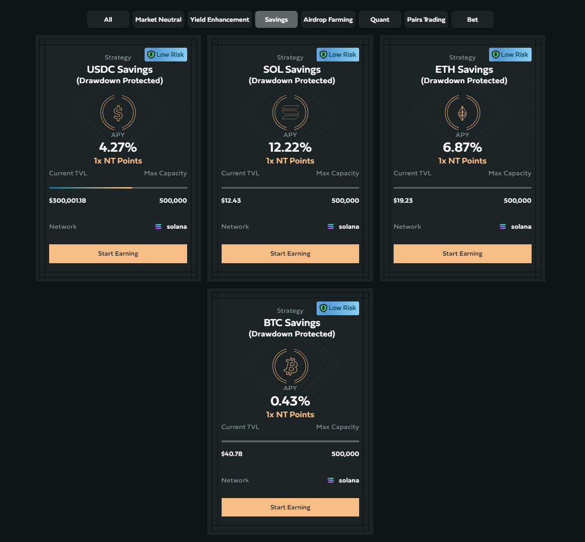

---
metaLinks:
  alternates:
    - >-
      https://app.gitbook.com/s/6YjCIQB3ardoMeqGMIF8/for-capital-allocators/deprecated-vaults/flexible-savings-deprecated/usdc-sol-btc-eth-savings-deprecated
---

# 🛡️ USDC/SOL/BTC/ETH 储蓄 -【已停用】

<figure><figcaption></figcaption></figure>

## 储蓄金库运作机制简析

储蓄金库的收益来源于 Drift 交易者（包括 Neutral Trade 自身的策略）支付的借贷费用。由于资产借出费率随市场波动，年化收益率也会相应变化，但始终维持稳定正收益。

这是获取蓝筹资产收益的最佳途径——特别适合追求稳健、低风险回报的用户。

<figure><figcaption></figcaption></figure>

立即存入 USDC、SOL、ETH 或 BTC 至我们的储蓄金库，锁定稳定收益——免受市场回撤风险影响。

全新“储蓄”专区已上线官网。当前利率（2025年3月11日）：

* **USDC**：4.27% 年化收益率
* **SOL**：12.22% 年化收益率
* **ETH**：6.87% 年化收益率
* **BTC**：0.43% 年化收益率

在赚取稳定收益的同时，还可叠加累积 **NT 积分**。

## **赎回周期**

储蓄类金库不设赎回锁定期，用户可随时立即存取资金。

## 风险提示

尽管储蓄策略被视为低风险且具备回撤保护，但仍存在特定风险，主要源于在 Drift 去中心化交易所（DEX）上的交易对手风险敞口。核心风险在于 Drift 平台的整体财务稳定性——若该交易所面临偿付能力问题，存放于其账户内的资金可能面临风险。

***

启用日期： 2025-03-11&#x20;
