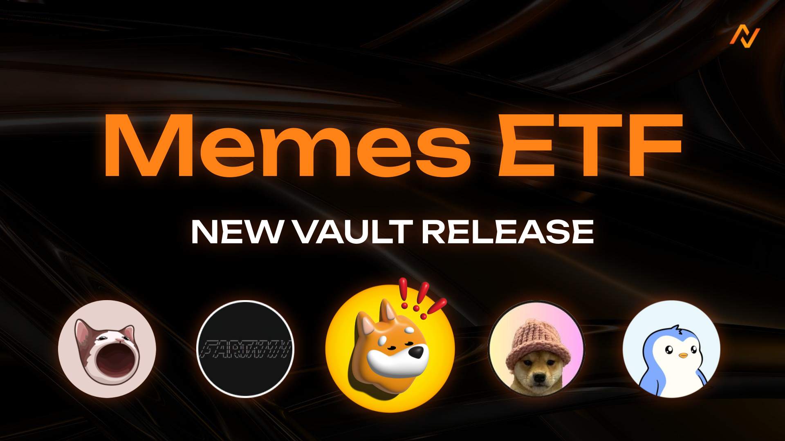

---
metaLinks:
  alternates:
    - >-
      https://app.gitbook.com/s/6YjCIQB3ardoMeqGMIF8/for-capital-allocators/deprecated-vaults/memes-etf-generational-wealth-deprecated
---

# 🐸 Memes ETF (世代财富) -【已停用】

<figure><figcaption></figcaption></figure>

**Solana Memes ETF** 是一款多元化、主动管理的指数型金库，旨在捕捉顶级 Solana Memecoin 的爆发式增长潜力。随着社区热度和市场对 Memecoin 的关注度不断提升，该金库为您提供了一种结构化的配置方式，让您能够精准布局我们精选的 Solana 生态 Meme 蓝筹组合。

**不想花时间研究 Meme 币，但又想参与其中？我们来帮您。**

Solana Memes ETF 已囊括最热门的 Solana Meme 币，采用市值加权并优化分散配置——您无需过度纠结，一键投入即可。

**BONK、FART、WIF、PENGU、POPCAT**——这仅仅是开始。随着生态发展，该 ETF 将持续进化，不断纳入新的 Meme 重量级项目。

## **Meme 指数金库产品说明**

<figure><figcaption></figcaption></figure>

#### 与其孤注一掷单个 Meme 币，何不把握整个赛道浪潮？

押注下一个爆款 Meme 币犹如赌博——可能一战封神，也可能归零离场。正因如此，我们推出了 Memes ETF 解决方案。

### **Memes ETF 核心功能：**

* 将资金**分散投资**于顶级 Solana Meme 币组合
* **精选优质标的**——如 BONK、FART、WIF、PENGU 及 POPCAT
* 基于市值加权高效捕捉行业增长红利

### **运作机制**：

1. 存入 USDC
2. NT 通过现货买入将资金分配到多个 Meme 币中
3. 每个 Meme 币的权重（例如 BONK 占最大份额）反映其市场主导地位——同时还能从 Drift 交易者支付的借贷费用中获得额外收益作为加成

### **紧跟 Meme 趋势动态调仓**：

Memes ETF 并非一成不变。随着市场机遇涌现，我们的量化团队与专业交易员将持续评估并调整持仓——适时纳入潜力 Meme 币，确保您的资产配置始终处于优化状态。

## **费用与赎回规则**

* **绩效佣金**：从本策略为您实现的收益中抽取 **10%**
* **管理费**：年化 **2%**（根据资金在库内的存续时长按日计提，每日费率约为本金的 **0.00548%**）

本策略设有 **1天** 的赎回锁定期。

## 交易查询入口 (Drift)


[https://app.drift.trade/?authority=AHfaqTwFhWiX2DZrYbTivBpbrstNJRyjHG4mFPVpJS5n](https://app.drift.trade/?authority=AHfaqTwFhWiX2DZrYbTivBpbrstNJRyjHG4mFPVpJS5n)


## 存入链接:

Neutral Trade 官网 (主要入口):


[https://www.app.neutral.trade/strategies/memesetf](https://www.app.neutral.trade/strategies/memesetf)


***

Memes Index 启用日期 — 2025-05-14
