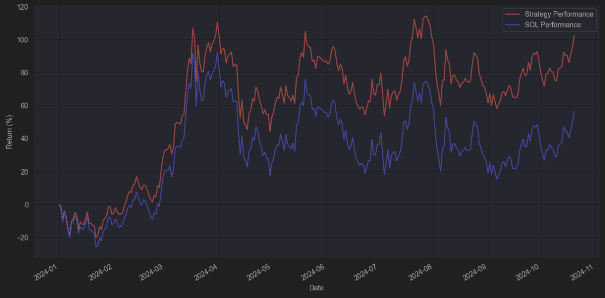

# 🟣 SOL 超级质押 -【已停用】

## SOL Super Drift Staking **策略解析**

**SOL Super Drift Staking** 是提升 Solana 经济安全性和 Jupiter Perp DEX 流动性的基石策略。

我们通过获取并抵押 dSOL 以赚取 SOL 流动性质押收益，随后以此抵押品开设借贷头寸，进一步在 dSOL 基础上运行 Delta 中性策略。

## **收益来源解析**

以下是本质押金库的核心收益来源解析：

1. **JLP 手续费收益**\
   截至 2025年9月12日，年化收益率 17.59%\
   来源：Jupiter Perp DEX 上交易者支付的交易费、借贷费、铸造/销毁费及清算费中的 75% 分成
2. **dSOL 质押收益**\
   截至 2025年9月19日，年化收益率 7.52%\
   来源：Solana 网络通胀奖励、优先费及 MEV 捕获机会
3.  **永续空头资金费率收益**

    截至 2025年9月19日各资产年化收益率：

    * ETH：约 7.92%
    * BTC：约 11.20%
    * SOL：约 3.02%\
      来源：永续合约市场中多头方向交易者通常向空头支付的资金费用

本策略让您在维持 Solana 资产敞口的同时，为持有的 SOL 赚取约**年化 15.98%** 的真实收益。

这是一种强大的最大化收益的方案，让您在保持与 Solana 生态系统深度协同的同时，既为 Solana 的经济安全提供支持，也为 Jupiter和 Drift 注入流动性。

<figure><figcaption></figcaption></figure>

## 关于dSOL

**dSOL（Drift SOL）** 是去中心化交易所 Drift 发行的 SOL 流动性质押代币。作为质押者，您可通过以下多种渠道获取收益：Solana 网络通胀奖励、优先手续费及 MEV 捕获机会。

若您熟悉 JitoSOL，可将 dSOL 视为其直接对标产品，只不过它由 Drift DEX 专门设计并发行。

> **关于流动性质押代币（LST）的补充说明：**\
> [https://www.bitcoin.com/get-started/what-is-a-liquid-staking-token/](https://www.bitcoin.com/get-started/what-is-a-liquid-staking-token/)

<figure><figcaption></figcaption></figure>

截至 2025年9月19日更新文档时，dSOL的年化收益率（APY）为**7.52%**，在当前市场中具备显著竞争力。

> [https://app.drift.trade/earn/dsol-liquid-staking](https://app.drift.trade/earn/dsol-liquid-staking)

## **传统 SOL 质押方案**

* **JitoSOL 收益循环（Kamino平台）** — 13.05% 年化收益率（存在脱锚风险）
* **纯质押模式（JitoSOL/JupSOL/dSOL）** — 约 8% 年化收益率
* **SOL 借贷收益** — 约 4% 年化收益率

**SOL Super Drift Staking 以独特策略突破收益上限，显著区别于市场同类方案。**

## **与原始 JLP Delta 中性金库的风险对比**

除[此文档](https://neutraltrade.medium.com/risks-of-the-jlp-delta-neutral-strategy-294d0899ece4)所述风险外，我们还要特别强调：存入本产品的资金将**完全暴露于 $SOL 的市场波动**。这意味着根据 $SOL 的价格走势，您既可能获得上涨收益，也可能承担下跌损失。 

## **交易查询入口** (Drift)


[https://app.drift.trade/?authority=EuSLjg23BrtwYAk1t4TFe5ArYSXCVXLBqrHRBfWQiTeJ](https://app.drift.trade/?authority=EuSLjg23BrtwYAk1t4TFe5ArYSXCVXLBqrHRBfWQiTeJ)


## 存入链接:

Neutral Trade 官网 (主要入口):


[https://www.app.neutral.trade/strategies/solnl](https://www.app.neutral.trade/strategies/solnl)


Drift 官网 (备选入口):


[https://app.drift.trade/vaults/strategy-vaults/EuSLjg23BrtwYAk1t4TFe5ArYSXCVXLBqrHRBfWQiTeJ](https://app.drift.trade/vaults/strategy-vaults/EuSLjg23BrtwYAk1t4TFe5ArYSXCVXLBqrHRBfWQiTeJ)


***

## 风险提示



***

Sol 超级质押启用日期 - 2024-10-21
