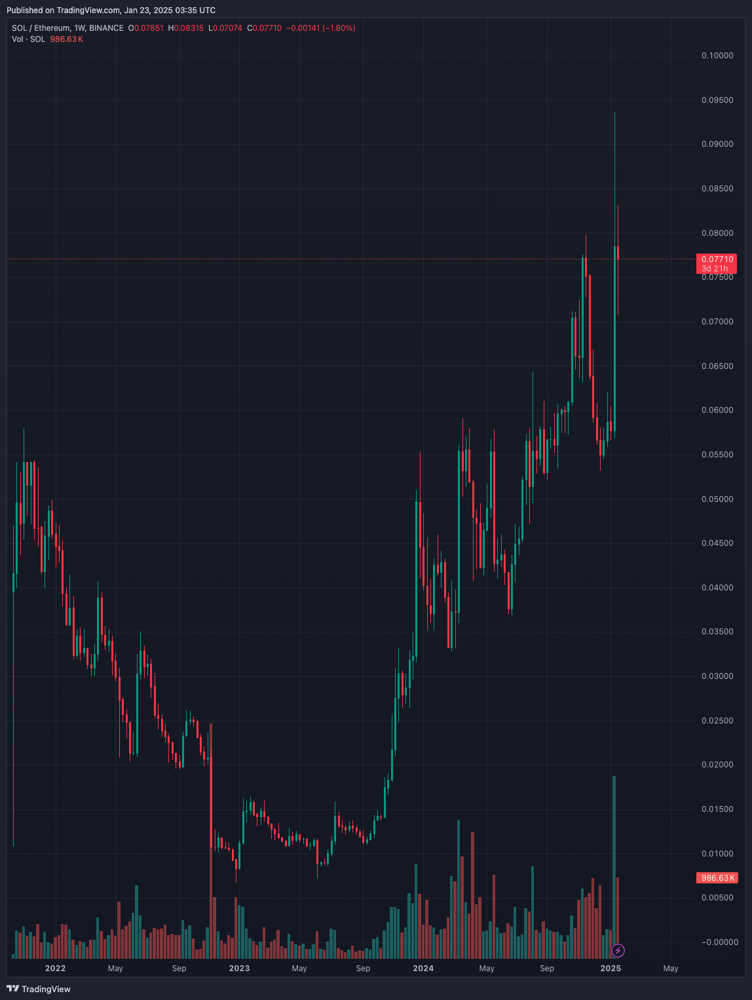

# SOL / ETH 轮动 -【已停用】

<figure><figcaption></figcaption></figure>

## 策略运作机制说明

配对交易通常涉及同时买入一种资产并卖出另一种相关资产，从而从两者的相对价格变动中获利，无需判断市场整体方向。

本配对交易金库在实现市场中性的同时，有效对冲市场波动风险。您唯一的风险敞口仅取决于 **SOL 相对于 ETH 的价格走势**，而无需承受大盘波动的影响。

本策略旨在保持 **50% 的 Solana 多头敞口**（同时通过 dSOL 获取流动性质押收益，截至2025年9月19日APY为7.52%），并维持等值美元的 **ETH 永续合约空头头寸**（在保持对 ETH 空头敞口的同时获取正向资金费率收益）。该策略将于每日或当 SOL 多头与 ETH 空头价值出现显著偏离时执行自动再平衡。

本产品专为 Solana 信徒打造，是您押注 Solana 终将超越以太坊的绝佳工具。

若 SOL 表现强于 ETH，您将获利；反之则可能产生亏损。当前 Solana 生态进展迅猛，市场热情高涨，增长势头已然明确。

**近期 SOL 的利好催化剂**：

* SOL ETF 即将推出
* $TRUMP 与 $MELANIA 在 Solana 上发行 Meme 币
* DEX 单日交易量达 175 亿美元，创下所有链上单日最高交易记录
* 真实经济价值（交易费 + MEV 收益）创历史新高，单日突破 5500 万美元

<figure><figcaption></figcaption></figure>

市场情绪正悄然转向：越来越多投资者看好 Solana 的增长潜力，而以太坊的统治地位则开始显现动摇迹象。

<figure><figcaption>
<a href="https://x.com/ryanwatkins_/status/1856351983268983145?s=46&#x26;t=6JwvRcZS51bj9Gcn25o7GA">https://x.com/ryanwatkins_/status/1856351983268983145?s=46&#x26;t=6JwvRcZS51bj9Gcn25o7GA</a>
</figcaption></figure>

<figure><figcaption>
SOL/ETH weekly chart since 2022
</figcaption></figure>


Solana outperforming Ethereum on all meaningful metrics ([https://solana.blockworksresearch.com/](https://solana.blockworksresearch.com/))



It's not a matter of IF, but WEN



Delphi Digital is bullish on Solana


押注 SOL 最终市值超越 ETH 具备巨大的上涨空间。目前Solana 市值仅约为以太坊的 30%。

<figure><figcaption>
<a href="https://marketcapof.com/solana/ethereum/">https://marketcapof.com/solana/ethereum/</a>
</figcaption></figure>

与此同时，以太坊基金会却在抛售资产，让持币者承受压力。



社区中流传着一个经典调侃：以太坊基金会"充分使用以太坊"——通过大量抛售 ETH 换取稳定币来支付员工薪酬。

<figure><figcaption></figcaption></figure>





<mark style="color:yellow;">**在 Neutral Trade 上存入，在支持 SOL 终将超越 ETH 的同时，抵御整体市场波动。**</mark>

**费用结构**：

* 绩效佣金：**10%**
* 年化服务费：**2%**

**赎回规则**：

* 锁定期：**1天**

## 交易查询入口 (Drift)


[https://app.drift.trade/?authority=2zsHAfvD2BpmZbuPhc32dija8cXu8ow6n2yzyZTMvQ8V](https://app.drift.trade/?authority=2zsHAfvD2BpmZbuPhc32dija8cXu8ow6n2yzyZTMvQ8V)


## 存入链接:

Neutral Trade 官网（主要入口）：


[https://www.app.neutral.trade/strategies/solethflip](https://www.app.neutral.trade/strategies/solethflip)


Drift 官网（次要入口）：


[https://app.drift.trade/vaults/strategy-vaults/2zsHAfvD2BpmZbuPhc32dija8cXu8ow6n2yzyZTMvQ8V](https://app.drift.trade/vaults/strategy-vaults/2zsHAfvD2BpmZbuPhc32dija8cXu8ow6n2yzyZTMvQ8V)


