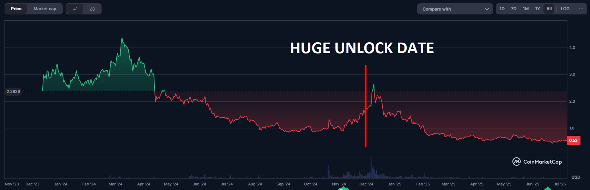
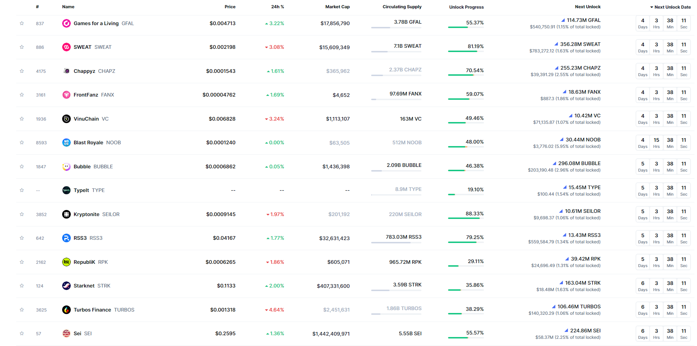
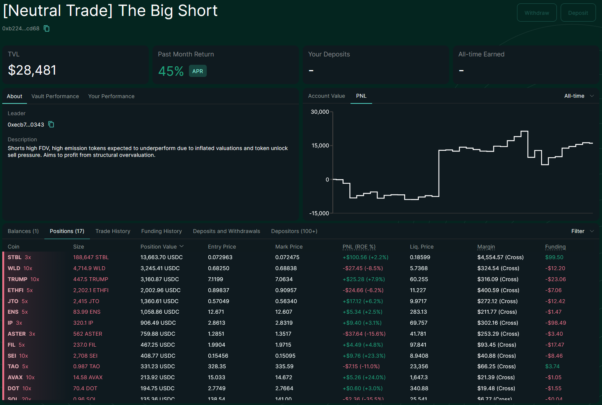

---
metaLinks:
  alternates:
    - >-
      https://app.gitbook.com/s/6YjCIQB3ardoMeqGMIF8/for-capital-allocators/deprecated-vaults/bet/hyperliquid-the-big-short
---

# 📉 \[Hyperliquid] The Big Short

人人皆言代币解锁，却鲜有人掌握正确的交易之道。

\
我们构建的策略专注于做空估值过高的代币，这些代币在解锁压力到来时极易下跌。 


在 Hyperliquid 平台注册时，请使用 Neutral Trade 推荐链接，即可享受**更低交易手续费**并解锁**未来专属权益**：

[https://app.hyperliquid.xyz/join/NEUTRALTRADE](https://app.hyperliquid.xyz/join/NEUTRALTRADE)


***

<figure><figcaption></figcaption></figure>

## 策略详解

每日有数百万计代币**解锁**进入市场。在流动性不足的环境下，这往往意味着被动抛压。我们实时追踪这些解锁动态，精准识别单日超 **50万美元** 以上的代币释放节点。

基于此数据，我们筛选出具备做空潜力的标的。

<figure><figcaption></figcaption></figure>

<figure><figcaption></figcaption></figure>

## **策略运作机制**

### **通胀系数** (IC)

$$
通胀系数 = 解锁量 / 流通市值
$$

* 该公式能有效识别最可能贬值的代币。
* **通胀系数越高 → 市场抛压越大 → 越适合作为做空标的。**

### **权重分配逻辑**

* 各代币的做空权重基于**其通胀系数动态分配**
* **通胀率越高 → 做空权重越大**
* 投资组合会根据实时数据**持续调整**仓位配比。

### **调仓逻辑**

**每小时**，算法会检测**当前持仓**与**目标权重**的偏差：

* **若任一偏差 > 20 美元**
  * 立即执行调仓

**每日**，当有**新资金注入**时：

* **若存入金额 > 5000 美元**
  * 按当前权重比例同步增持空头仓位

## **选择 Hyperliquid 金库的理由**

* **原生策略执行**：**无需管理机器人或基础设施，**&#x5373;可在链上自动运行策略
* **极简信任模型**：用户无需支付 Gas 费，操作门槛大幅降低
* **高效执行引擎**：基于 Hyperliquid 订单簿交易，实现快速、大规模精准执行

<figure><figcaption></figcaption></figure>

## 存入链接:

> #### [https://app.hyperliquid.xyz/vaults/0xb2246d6f3ddeeca74cfd29dc3cce05c1746fcd68](https://app.hyperliquid.xyz/vaults/0xb2246d6f3ddeeca74cfd29dc3cce05c1746fcd68)

***

启用日期 - 2025-06-09
