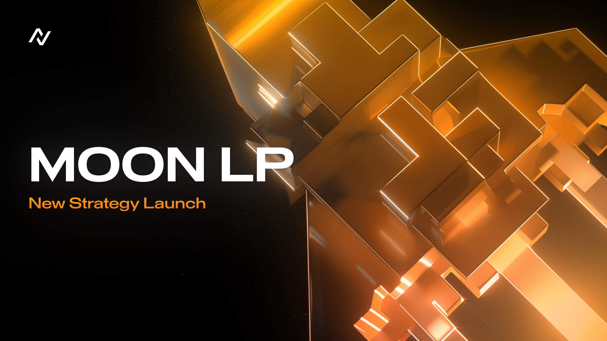

---
metaLinks:
  alternates:
    - >-
      https://app.gitbook.com/s/6YjCIQB3ardoMeqGMIF8/for-capital-allocators/deprecated-vaults/indexes/moon-lp
---

# 🌝 Moon LP

### 引言

Solana 永续合约生态正在快速扩张，但流动性碎片化仍是可持续发展的主要障碍之一。各交易场所争抢流动性存款，导致市场深度不足、流动性分散以及交易执行质量不一致等问题。

Moon LP 通过充当跨平台流动性引擎来解决这一问题。该策略会自动在 Adrena、Flash Trade 和 Jupiter 等多个永续合约平台之间动态配置资金，实现流动性的高效分配。

这种机制不仅有助于提升流动性提供者（LP）的收益表现，同时也能够增强 Solana 永续合约市场的整体流动性、交易效率和生态健康度，从而促进整个市场的长期稳定发展。

***

<figure><figcaption></figcaption></figure>

### **Moon LP 为何对 Solana 生态至关重要**

* **跨 DEX 统一流动性**：Moon LP 不再让资金困于孤立的流动性池，而是将其整合为单一策略，同时为多个永续合约市场注入活力。这带来了更深的订单簿、更优的交易执行效果，并为整个 Solana 生态的交易者降低了滑点。
* **更具韧性的市场结构**：通过动态再平衡流动性，Moon LP 有效避免了资金过度集中于单一场所带来的脆弱性。更健康的资金分布意味着更低的系统性风险。
* **生态协同激励**：Moon LP 与 Flash Trade、Adrena 共同构建激励体系，推动各方参与者致力于促进整个永续合约市场的成长，而非仅关注单一平台。

<figure><figcaption></figcaption></figure>

***

### Depositors**Moon LP 为资金存入者带来的核心价值**

对流动性提供者而言，其价值主张清晰明确：:

1. **多元化敞口 = 降低交易对手风险：**&#x4F20;统流动性提供模式将资金集中于单一交易场所，若该 DEX 表现不佳或面临运营风险，用户将完全暴露于风险中。Moon LP 通过动态分配存款，显著降低了因单一平台问题而导致损失的可能性。
2. **通过动态分配实现收益优化**：Moon LP 无需手动追逐收益，而是自动将资金分配至利用率最高的市场。这确保了流动性提供者能够实时捕获最佳回报，无需主动管理。
3. **被动策略，专业执行**：存入者无需持续监控利差、手动调仓或在各平台间转移资金。Moon LP 通过专业级算法自动完成所有执行环节。
4. **早期激励短期加成:** 早期参与者可获得总值 **4,000 美元**的奖励（包括 2,000 美元 $ADX 与 2,000 美元$FAF），奖励分两周发放，进一步提升初始收益。 

<figure><figcaption></figcaption></figure>

***

### **激励计划细则**

* **激励总额**：2,000美元等值 $ADX + 2,000 美元等值 $FAF
* **活动周期**：2周（自策略上线起计算）
* **分配规则**：根据用户存款金额按比例发放

本激励计划作为短期启动催化剂，旨在快速积累初始锁仓价值、吸引早期参与者，并为评估策略长期可持续性提供关键数据支撑。

<figure><figcaption></figcaption></figure>

***

### **核心价值**

* **Solana 永续生态**：获得更深流动性、更窄价差，构建更健康的市场环境；
* **Adrena及合作平台**：通过协同激励推动合作共赢，打破零和竞争；
* **资金存入用户**：享受更安全、更智能、收益更优的流动性提供体验；

Moon LP 标志着 Solana 流动性供给的下一代演进：资本高效、风险可控、与生态发展共生。

***

### 启用日期 - 2025-09-29
