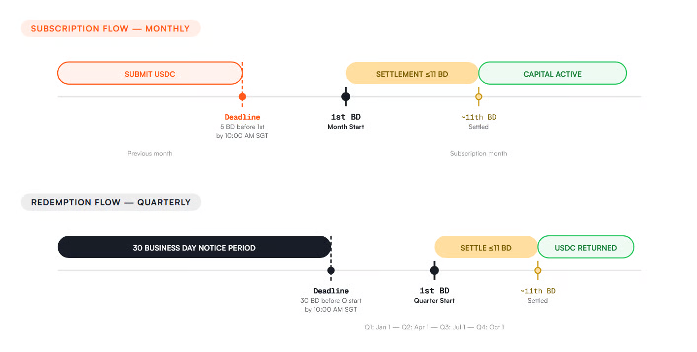

# 多资产波动率套利策略

### 概览

* 通过系统化的相对价值与波动率套利策略，在传统市场与另类市场中捕捉全球波动率风险溢价。
* 系统性扫描高流动性的股票与固定收益工具，以及 VIX 衍生品，并识别最有效的工具来表达波动率观点。
* 特别关注数字资产作为结构性丰富的波动率风险溢价资产类别，提供独特且尚未充分开发的机会。
* 同时交易与数字资产相关的美国股票代理标的，例如 Bitcoin ETF、MicroStrategy、Coinbase 以及 BTC 指数，从而通过受监管且高流动性的工具高效获取数字资产波动率敞口。

<table data-view="cards"><thead><tr><th></th><th data-hidden data-card-target data-type="content-ref"></th></tr></thead><tbody><tr><td><strong>DEPOSIT</strong></td><td><a href="https://www.neutral.trade/strategies/volatility-alpha-strategy-1">https://www.neutral.trade/strategies/volatility-alpha-strategy-1</a></td></tr></tbody></table>

_于 2026 年 3 月 30 日上线_

***

### 业绩表现

<figure><figcaption></figcaption></figure>

| 年份   | 一月    | 二月    | 三月     | 四月     | 五月    | 六月    | 七月    | 八月    | 九月     | 十月     | 十一月   | 十二月   | 年初至今回报率    |
| ---- | ----- | ----- | ------ | ------ | ----- | ----- | ----- | ----- | ------ | ------ | ----- | ----- | ---------- |
| 2026 | 1.75% | 1.55% | —      | —      | —     | —     | —     | —     | —      | —      | —     | —     | **3.33%**  |
| 2025 | 1.47% | 0.31% | -1.15% | -0.16% | 2.09% | 1.27% | 1.30% | 1.15% | 1.99%  | 1.99%  | 1.37% | 1.48% | **13.88%** |
| 2024 | 1.15% | 1.07% | 1.06%  | 0.48%  | 1.36% | 1.05% | 1.12% | 1.51% | -0.42% | -0.71% | 2.49% | 0.97% | **11.67%** |

#### 业绩统计

| 指标        | 数值     |
| --------- | ------ |
| 年化收益率（净值） | 13.43% |
| 夏普比率      | 2.96   |
| 最大回撤      | -1.3%  |
| 年化波动率     | 3.01%  |

> 过往业绩并不一定代表未来表现。所提供的预估收益仅供参考，未必能够反映实际投资表现。所列收益数据均为 Neutral Trade 收取相关费用及支出之前的收益表现。

***

### 风险管理

风险管理框架以资本保全为核心，通过严格的分散化原则和流动性管理要求来控制风险。

投资组合构建遵循审慎的集中度限制，覆盖传统资产和数字资产两大领域，确保整体敞口保持充分分散，并集中于流动性高、市值大的资产。

财务稳健性通过保守的杠杆水平和主动保证金管理来维持，从而为应对突发市场波动预留充足缓冲空间。

为降低下行风险，策略采用：动态回撤触发机制；针对极端市场情景的持续压力测试；每日仓位调整。以确保整体风险状况始终符合长期稳健运营目标。

***

### Neutral Trade 认购条款

| 参数                            | 详情                                                 |
| ----------------------------- | -------------------------------------------------- |
| 策略 (Strategy)                 | 多资产波动率套利 (Multi-Asset Volatility Arbitrage)        |
| 管理人 (Curator)                 | D\* Research                                       |
| 认购币种 (Subscription Currency)  | USDC（美元稳定币）                                        |
| 最低认购金额 (Minimum Subscription) | USDC 50,000                                        |
| 最低赎回金额 (Minimum Redemption)   | USDC 50,000                                        |
| 年度服务费 (Annual Service Fee)    | 1%                                                 |
| 佣金 (Commission)               | 0%                                                 |
| 认购频率 (Subscription Frequency) | 每月（每个日历月第一个工作日前 5 个工作日）                            |
| 赎回明细 (Redemptions)            | 每季度，每个日历季度的第一个工作日。结算时间为 11 个工作日内。USDC 在结算后 3 天内返还。 |
| 赎回需知 (Redemption Notice)      | 需提前 30 天通知，于每个日历季度第一个工作日之前                         |
| 赎回门槛 (Redemption Gate)        | 每季度上限为产品资产管理规模（AUM）的 25%（2 亿美元）                    |
| 经纪商与托管方 (Broker & Custodian)  | 纳斯达克（NASDAQ）、纽约证券交易所（NYSE）、芝加哥商品交易所（CME）           |

<figure><figcaption></figcaption></figure>

***

### 为什么 Neutral Trade 选择这个策略

Neutral Trade 在将该策略选为平台首个非纯加密资产相关策略之前，已通过严格的尽职调查流程对其进行了全面审核和筛选。

我们选择该策略的主要原因包括：

* **业绩记录：** 自 2025 年 4 月策略成立以来，持续实现月度正收益。上线前的回测数据及内部实盘交易记录可追溯至 2024 年 1 月。该策略展现出了优秀的风险调整后收益表现。
* **风险管理框架：** 采用机构级风险控制体系，包括严格的杠杆上限、动态回撤控制机制、每日压力测试以及保守的保证金管理。
*   &#x20;**结构性 Alpha 来源：** 波动率风险溢价是一种经过充分研究验证且长期存在的收益来源。

    该策略能够同时参与传统金融市场和数字资产市场的波动率交易，从而获得差异化且尚未被充分开发的投资机会。

***

### 免责声明

本材料仅供参考之用，不构成出售任何证券或策略的要约、购买任何证券或策略的要约邀请，亦不构成任何投资建议。过往业绩并不一定代表未来表现，且无法保证该策略未来能够取得与历史表现相当的业绩，亦无法保证实现任何目标收益。

投资波动率策略涉及重大风险，包括本金损失风险。投资价值可能发生波动，投资者可能无法收回其最初投入的全部资金。与数字资产相关的投资工具还面临额外风险，包括监管环境的不确定性以及较高的市场波动性。

Neutral Trade 不提供投资、法律或税务建议。潜在投资者在作出任何投资决定前，应先咨询自身的专业顾问。
