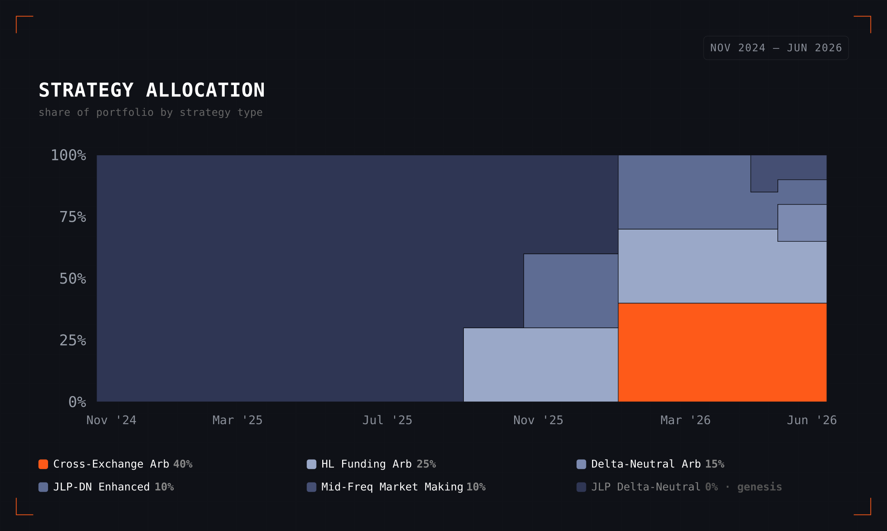
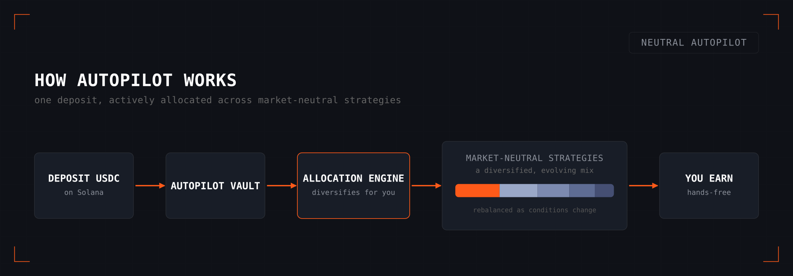

# Neutral Autopilot

One deposit. Neutral Trade's strategies, managed for you.

## Overview

Neutral Autopilot is Neutral Trade's multi-strategy vault, built around a market-neutral core. A single USDC deposit gives you a professionally managed portfolio spanning several of the platform's strategies. It is primarily market-neutral, with up to 5% allocated to directional strategies when the risk-adjusted case is compelling.

Autopilot aims to earn steadily whether crypto is rising or falling.

<table data-view="cards"><thead><tr><th></th><th data-hidden data-card-target data-type="content-ref"></th></tr></thead><tbody><tr><td>DEPOSIT</td><td><a href="https://www.neutral.trade/strategies/neutral-autopilot">https://www.neutral.trade/strategies/neutral-autopilot</a></td></tr></tbody></table>

_Live since July 2026_


Autopilot is the current production vault in the [Neutral VIP Program](../getting-started/neutral-vip-program.md). Eligible wallets can reduce the standard annual management fee to **0.90% (Silver), 0.80% (Gold), or 0.70% (Diamond)** through either an NT Points path or a direct Autopilot-balance path.


## Key Facts

| Item                  | Detail                                                                                                                          |
| --------------------- | ------------------------------------------------------------------------------------------------------------------------------- |
| **Strategy type**     | Multi-strategy vault with a market-neutral core                                                                                 |
| **Curator**           | Neutral Trade                                                                                                                   |
| **Deposit asset**     | USDC on Solana. USDC on Ethereum is supported through Accountable Vaults                                                        |
| **Minimum deposit**   | 100 USDC                                                                                                                        |
| **Management fee**    | 1% per year on Solana. VIP tiers reduce it to 0.90%, 0.80%, or 0.70%                                                            |
| **Performance fee**   | None charged by Autopilot on Solana                                                                                             |
| **Withdrawal fee**    | 0.3%                                                                                                                            |
| **Deposits**          | Accepted daily                                                                                                                  |
| **Redemptions**       | Weekly. Requests made from Monday to Sunday join the Monday 00:00 UTC cutoff and are redeemed on the Saturday after that cutoff |
| **Directional limit** | 5% of the portfolio                                                                                                             |
| **Live since**        | July 2026                                                                                                                       |

The vault's Details view in the app shows the current terms, including any active fee promotion. If a figure on this page differs from the Details view, the Details view is correct.

## Why Autopilot?

Neutral Trade offers a growing set of strategies: funding arbitrage, cross-exchange arbitrage, market making, and more. Each is strong on its own, but choosing and managing them yourself is harder than it looks.

* **Which do you pick?** Every strategy earns differently, so choosing well means learning how each one actually makes money.
* **The lead keeps changing.** The strategy that leads this month may trail the next, so keeping up means watching all of them and moving your capital at the right time.
* **Concentration is a gamble.** Put everything in one strategy and you're exposed to its slow stretches, with no clear signal for when to switch.

For most people, that's more time and attention than it's worth.

**Autopilot removes the guesswork.** A single deposit puts your capital to work across a diversified mix of Neutral Trade's strategies, and the allocation engine manages it from there. It weighs how the strategies behave together, leans toward the strongest risk-adjusted performers, and adds new strategies to its opportunity set as they release.

<figure><figcaption>
Historical allocation by strategy type, November 2024 to June 2026. The current allocation is different. See What Autopilot Allocates To.
</figcaption></figure>

What you get:

* **One position, broad exposure.** A diversified, primarily market-neutral portfolio, without choosing a single strategy.
* **Managed for you.** Rebalanced and kept current automatically, with nothing to track, time, or switch.
* **Yield, not direction.** Returns come mainly from structural sources like funding, spreads, and arbitrage, with a small directional sleeve (up to 5%) for added upside when the risk-adjusted case is there. Diversification cushions any single strategy's slow stretches.

**Access, without the overhead.** Reaching these strategies directly has typically meant a $1M minimum, a fund subscription, and quarterly redemptions. Autopilot replaces that with a 100 USDC minimum and weekly redemptions, through audited smart contracts. This is what we mean by hedge fund strategies, on-chain, for everyone. [See Our Thesis for the full picture.](../getting-started/our-thesis.md)

## What Autopilot Allocates To

Autopilot allocates to strategies that are live on Neutral Trade. On 12 October 2026, the portfolio held these strategies:

| Sleeve                              | Strategies                                                                                                                                                                                                                                                                                                                                         |
| ----------------------------------- | -------------------------------------------------------------------------------------------------------------------------------------------------------------------------------------------------------------------------------------------------------------------------------------------------------------------------------------------------- |
| **Market-neutral core**             | [Delta Neutral Arbitrage](market-neutral/delta-neutral-arbitrage.md), [Hyperliquid Funding Arb](market-neutral/hyperliquid-funding-arb.md), [Options Market Making](market-neutral/options-market-making.md), [HFT Multi-factor](market-neutral/hft-multi-factor.md), [Mid-frequency Market Making](market-neutral/mid-frequency-market-making.md) |
| **Directional sleeve (maximum 5%)** | [CTA - Adaptive Alpha](directional/cta-adaptive-alpha.md), [CTA - Systematic Alpha](directional/systematic-alpha.md), [CTA - Longshort Alpha](directional/cta-longshort-alpha.md)                                                                                                                                                                  |
| **Other**                           | A small balance in [NT Earn](nt-earn.md)                                                                                                                                                                                                                                                                                                           |

The set is not fixed. It grows as Neutral Trade lists new strategies, and a strategy must run live on Neutral Trade for a prolonged period before it can receive an allocation.

Weights change as the allocation engine rebalances. The Autopilot page in the app shows the live allocation, with the amount in each strategy and its share of the portfolio.

## How It Works

<figure><figcaption></figcaption></figure>

1. **Deposit USDC.** You make a single USDC deposit into the Autopilot vault.
2. **Your capital goes to work.** It's spread across a selection of Neutral Trade's live strategies, primarily market-neutral with up to 5% directional, and rebalanced between them as conditions change.
3. **You earn, hands-free.** Returns from those strategies are reflected in your balance while you do nothing. No strategies to pick, no timing, no rebalancing on your end.
4. **Withdraw when you're ready.** Redeem on the vault's redemption schedule.

Full deposit and withdrawal mechanics are on [How They Work](../neutral-strategy-vaults/how-they-work.md).

### How the Allocation Engine Works

* **Target weights.** An optimization layer sets a target weight for each strategy. It uses the historical and expected return of each strategy, the correlation between strategies, volatility and tail risk, and internal risk limits.
* **Monitoring.** Autopilot tracks the NAV and the pending flows of each strategy, the live weight of each strategy, and the gap between live weights and target weights.
* **Rebalancing.** Autopilot rebalances when live weights move materially away from target weights. A deadband filters out small deviations, so the portfolio does not pay for unnecessary turnover.
* **Flows.** New deposits first fill strategies that are below their target weight. Withdrawals come first from strategies that are above their target weight.
* **Isolation.** Each underlying strategy sits in its own isolated vault, so a loss in one strategy is limited to the capital allocated to it.
* **Directional cap.** A hard cap keeps directional strategies at or below 5% of the portfolio.

## Autopilot on Ethereum

Autopilot started on Solana. Ethereum is also supported: USDC holders on Ethereum can deposit into Neutral Autopilot through **Accountable Vaults**. The Ethereum vault follows the same strategy as the Solana vault. In the app, open the Autopilot page and select **Deposit on another network**.

* Each network has its own vault. You withdraw on the network you deposited on.
* The Ethereum vault has its own fees, minimums, and withdrawal timing. The Details view lists the terms for each network.
* The VIP Program and the weekly redemption schedule on this page apply to the Solana vault.
* More networks are marked **Coming soon** in the app.

## Performance

Between November 2024 and June 2026, Autopilot returned +35.0%, and it did so with very little downside: its deepest fall from a high point was just 2.2%, and annualized volatility was 4.3%. On 12 October 2026, the app showed a Sharpe ratio (return relative to risk) of 3.36 for Autopilot.

**Ahead of stocks and crypto, with a fraction of the swings.** Over the same period, the S\&P 500 returned +24% (with a 19% drop along the way), and Bitcoin ended down 19%, having climbed as high as +65% before a 51% peak-to-trough fall. Autopilot compounded steadily through both, which is the point. It doesn't need the market to go up.

<figure><figcaption></figcaption></figure>

**Positive in 19 of its 20 months.** No single month fell more than 1.2%, and the 2.2% above is the deepest high-to-low slide across the whole period, not any one month. That month-to-month consistency is what compounds into the steady overall climb.

<figure><figcaption></figcaption></figure>

### Monthly Returns

Monthly returns, gross of fees, as shown in the app on 12 October 2026.

| Year | Jan   | Feb   | Mar   | Apr   | May   | Jun   | Jul   | Aug   | Sep   | Oct   | Nov   | Dec   | Year       |
| ---- | ----- | ----- | ----- | ----- | ----- | ----- | ----- | ----- | ----- | ----- | ----- | ----- | ---------- |
| 2024 | –     | –     | –     | –     | –     | –     | –     | –     | –     | –     | +5.6% | +4.4% | **+10.2%** |
| 2025 | +5.5% | -1.2% | +0.9% | +0.6% | +1.2% | +1.3% | +2.3% | +1.6% | +1.2% | +1.0% | +0.7% | +0.7% | **+16.9%** |
| 2026 | +1.4% | +0.7% | +0.6% | +0.6% | +0.7% | +0.8% | +1.7% | +0.4% | +1.1% | –     | –     | –     | **+8.3%**  |

The 2026 figure covers January to September. From November 2024 to September 2026, 22 of 23 months were positive.

Autopilot opened to deposits in July 2026. The months before July 2026 are pre-launch and reflect the track record of the underlying strategies. The app shows the live figures and lets you switch between gross and net returns.

## Risk Factors

Autopilot is primarily market-neutral, but it is not risk-free. As a multi-strategy vault, it takes on the risks of the strategies it allocates to. The main ones:

* **Strategy risk.** Each underlying strategy has its own risks, such as funding rates turning negative, forced liquidation or auto-deleveraging on leveraged positions, and adverse selection on market-making trades. Up to 5% of the portfolio may be allocated to directional strategies, which carry market-direction risk and can lose value if the market moves against that position. The 5% cap limits the impact of this sleeve on the vault as a whole. Spreading capital across several strategies, venues, and curators limits the impact of any single strategy, but does not remove these risks.
* **Allocation risk.** The allocation engine leans toward recent risk-adjusted performers, so it can lag a sudden change in market conditions. Allocations are monitored and adjusted continuously.
* **Centralized-exchange counterparty risk.** Some strategies trade on centralized exchanges, which exposes them to venue failure, insolvency, or disruption. Positions there utilize off-exchange custody and settlement.
* **On-chain and smart-contract risk.** Other strategies trade directly on on-chain venues such as Hyperliquid and Lighter, inheriting the smart-contract, oracle, and protocol risk of those venues. A bug, exploit, or failure at a venue or in the vault's own contracts could cause loss, and this cannot be eliminated entirely.
* **Operational risk.** Execution depends on the continuous availability of trading infrastructure, exchange APIs, and custody integrations. Disruption at any of these can delay rebalancing.

The [Risk Overview](risk-overview/) covers these risks in more detail.

## Trust & Security

Curators cannot withdraw client assets. Every movement is restricted, programmatically, to pre-approved contracts and venues.

On-chain operations run through Fordefi, which includes its MPC workspace, policy engine, admin quorum, and a 12-hour timelock on smart contract changes.

Centralized-exchange positions settle off-exchange via Copper (ClearLoop) and Ceffu (MirrorX), reducing exposure to exchange insolvency.

**Four independent audits.** The Solana vault program has been audited by Halborn (January 2025), Quantstamp (June 2025), Offside Labs (December 2025), and Adevar Labs (October 2026). All four reports are public on the [Security](../neutral-strategy-vaults/security.md) page.

**Who runs the strategies.** Neutral Trade's own strategies are managed in-house by a team with Goldman Sachs and top-tier hedge-fund backgrounds. Third-party strategies are run by independent curator teams, each admitted only after Neutral Trade's [Curator Selection](../curators/curator-selection.md) review, which includes a verifiable track record, documented risk and leverage limits, and an operational check; teams with unverifiable records are declined.

**What you can check.** The Autopilot page in the app shows the live allocation: each strategy, the amount in it, and its share of the portfolio. It also shows live risk data aggregated from the underlying vaults, including the venues in use, the custodians that hold collateral, and the exposure on each exchange.

**Three-party NAV verification.** The NAV of the underlying strategies is verified daily by three parties: Neutral Trade, the trading firm, and Accountable.


**Coming soon: Autopilot as a token**

Autopilot is planned to be the first vault on [Neutral Tokenize](neutral-tokenize.md). Your position becomes a token that you hold in your own wallet while it stays invested in the vault. It is not live yet, and no launch date is announced.


## Common Questions

**What is Neutral Autopilot?**

A multi-strategy vault. One USDC deposit is allocated across Neutral Trade's live strategies and rebalanced for you.

**Can I deposit from Ethereum?**

Yes. Ethereum is supported through Accountable Vaults. Select **Deposit on another network** on the Autopilot page in the app.

**Can I choose which strategies Autopilot uses?**

No. The allocation engine sets the weights. If you want your own mix, you can deposit into the individual strategies directly.

**How often does Autopilot rebalance?**

There is no fixed calendar. Autopilot rebalances when live weights move materially away from target weights.

**Does Autopilot take directional risk?**

A maximum of 5% of the portfolio can sit in directional strategies. The rest is in market-neutral strategies.

**When can I withdraw?**

On Solana, you can submit a withdrawal request on any day. The request joins the next Monday 00:00 UTC cutoff and is redeemed on the Saturday after that cutoff. You stay exposed to the vault's share price until settlement. See [Fees + Redemption Period](../additional-info/fees-+-redemption-period.md).

**Are returns guaranteed?**

No. Autopilot can lose money. Past performance does not indicate future results.

**Where do I see the current allocation?**

On the Autopilot page in the app.

## Further Reading

* [Key Design Considerations for Neutral Autopilot](https://www.neutral.trade/blog/neutral-autopilot-design-considerations)
* [The On-Chain Multi-Strat Vault](https://www.neutral.trade/blog/neutral-autopilot-multi-strat-vault)
* [Risk Management, Monitoring, Rebalancing & Strategy Allocation](https://www.neutral.trade/blog/neutral-autopilot-risk-rebalancing)
* [An Intelligent Capital Management Layer for Unified CeDeFi Operations](https://www.neutral.trade/blog/neutral-autopilot-cedefi-infrastructure)
* [The Product Looks Simple. This Was the Work.](https://www.neutral.trade/blog/neutral-autopilot-engineering)

> ### Ready to start?
>
> [Autopilot →](https://www.neutral.trade/strategies/neutral-autopilot)
>
> Fees, minimum deposit, and the redemption schedule for this vault are shown in the app.

_Products referenced are not intended for individuals in the United States, Mainland China, Hong Kong, sanctioned, or other restricted jurisdictions. This page is for informational purposes only and does not constitute an offer, solicitation, or recommendation to buy or sell any financial instrument. Digital-asset strategies involve significant risk, including possible loss of principal. See the_ [_Risk Warnings and Disclaimers Statement_](../legal/risk-warnings-and-disclaimers-statement.md)_._
