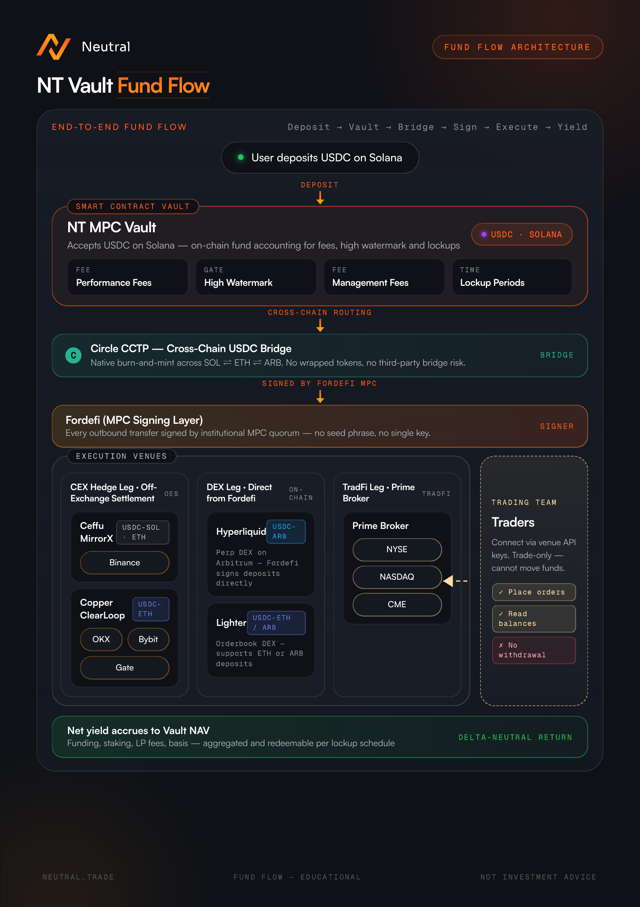

# How They Work

Neutral Strategy Vaults are the infrastructure layer that connects your deposit to the strategies run by Neutral Trade and its curators. This page explains how deposits and withdrawals work, and what happens to your capital between the two.

## What Curators Can and Can't Do

You deposit into a vault from your own wallet. Most vaults accept USDC on Solana. Some vaults accept deposits on another network, such as Ethereum, and the app shows the network on each vault. You do not bridge funds or open exchange accounts.

Behind the scenes, the vault deploys capital to execution venues: centralized exchanges, decentralized exchanges, or DeFi protocols, depending on the strategy.

The vault operates within a walled garden. Neither Neutral Trade nor any curator can move your funds to arbitrary external addresses. Curators, the trading teams who manage strategies within Neutral Strategy Vaults, have access to execute trades. They can adjust positions, rebalance, and manage the strategy. All movements are restricted to pre-approved contracts and venues. They cannot withdraw or redirect your assets.

For a full breakdown of the protections in place, see [Vault Protections](vault-protections.md).

<figure><figcaption></figcaption></figure>

## Depositing

**1. Connect your wallet.** Connect a wallet for the vault's network, or sign in with email or Google.

**2. Submit a deposit request.** Enter the amount you want to deposit and submit the request. A few things to be aware of:

> **Deposit requests cannot be cancelled once submitted.** Review the amount carefully before confirming.

> **If the vault has reached its TVL cap, your request will be rejected.** Check the vault's current capacity on the app before submitting.

Minimum deposit amounts vary by vault. Most strategy vaults start at 100 USDC. While a deposit is pending you can still add to it with another deposit request, but you cannot request a withdrawal until your pending deposit has been processed.

**3. Your deposit is processed and shares are issued.** Deposits are batched and processed together. Once processed, your funds are deployed into the strategy and you receive vault shares representing your proportional ownership of the vault's total assets. Your share price moves with the strategy's performance from this point forward.

## While Your Capital Is Deployed

Once deployed, your capital is actively managed by the strategy. Share prices update as the strategy earns or loses. Fees are deducted periodically. Some vaults have a lockup period before you can request a withdrawal. These terms are listed in each vault's Details view in the app.

## Withdrawing

**1. Submit a withdrawal request.** You can request a withdrawal after any applicable lockup period has ended. Some vaults have their own terms. For example, [Multi-Asset Volatility Arbitrage](../for-capital-allocators/rwa/multi-asset-volatility-arbitrage.md) has quarterly redemptions with a notice period.

> **Withdrawal requests cannot be cancelled once submitted.**

You can only have one withdrawal request in flight at a time, so you cannot submit another until this one is processed. You can, however, still make a deposit while a withdrawal is pending.

**2. Redemption period.** After submitting, your request joins the vault's next cutoff (00:00 UTC) and is redeemed on the redemption day for that cutoff. Most vaults follow a once-weekly schedule (Friday redemptions) or a twice-weekly schedule (Monday and Friday redemptions), and Neutral Autopilot redeems on Saturday. The full schedule, and the vaults on each one, are on [Fees + Redemption Period](../additional-info/fees-+-redemption-period.md).

**3. Funds are returned to your wallet.** After the redemption period, your funds are automatically returned to the wallet that made the deposit, net of any applicable withdrawal fee, management fee, and performance fee. Your vault shares are burned, reflecting your exit from the vault.

You stay exposed to the vault's share price, up and down, until settlement.

## Switching Between Vaults

If you want to move from one vault into another that uses the same deposit asset (for example, from one USDC vault to another), you can switch directly instead of withdrawing to your wallet and depositing again.

A switch follows the source vault's normal redemption timing: the same lockup and redemption period apply. At the end of that period your capital moves straight into the destination vault, where it is deployed and issued new shares. You don't pay a redundant withdrawal fee: the only withdrawal-side cost is the difference if the source vault's withdrawal fee is higher than the destination's. The destination vault's deposit fee still applies.

If the destination vault can't accept the funds when the switch completes (for example it is paused, or the amount is below its minimum or above its remaining capacity), your capital is returned to your wallet instead.

## Common Questions

**What do I receive when I deposit?**

Vault shares. They record your proportional ownership of the vault, and their price follows the strategy's net asset value.

**How long does a withdrawal take?**

It depends on the vault's schedule. Most vaults redeem once or twice a week. See [Fees + Redemption Period](../additional-info/fees-+-redemption-period.md).

**Can I hold my position as a token?**

Not yet. [Neutral Tokenize](../neutral-tokenize/overview.md) is coming soon.
